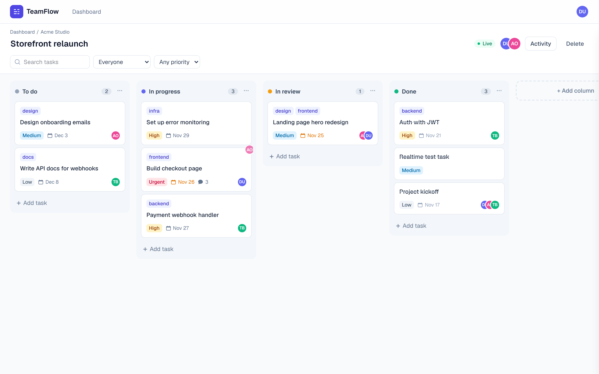
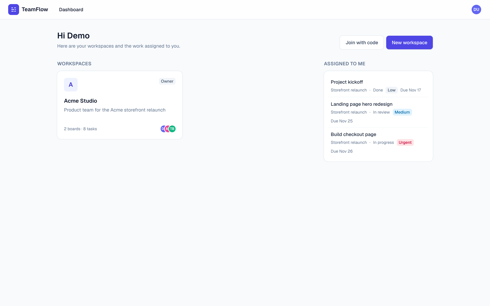
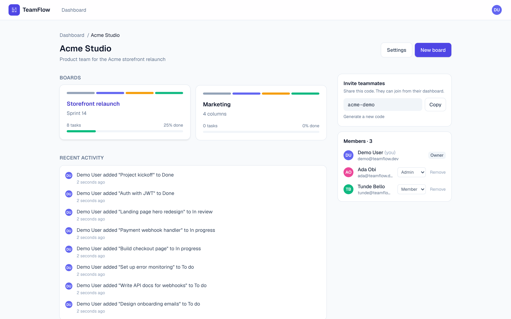
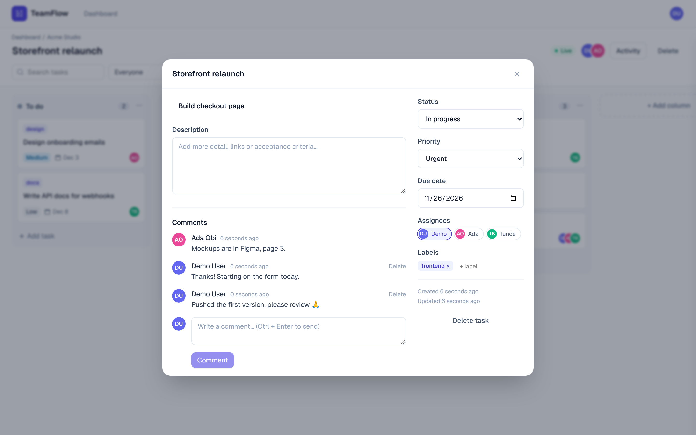

# TeamFlow: real time team task manager

A full stack kanban app where every change syncs live between teammates. Create a workspace, invite your team with a code, and plan work on drag and drop boards. Moves, edits, comments and who is online show up for everyone instantly, without refreshing.



**Live demo:** _add your Vercel URL here_ · **Demo login:** `demo@teamflow.dev` / `password123` (invite code `acme-demo`)

## Features

- **Real time boards.** Task creates, edits, moves, deletes, column changes and comments are pushed to everyone on the board over Socket.io.
- **Presence.** See who is on the board right now, and an avatar on any card a teammate has open.
- **Drag and drop** for cards and columns, with mouse, touch or keyboard (space to lift, arrows to move). Updates are optimistic, so the UI never waits for the network.
- **Workspaces and roles.** Owner, admin and member roles, invite codes you can rotate, member management and leaving a workspace.
- **Task details.** Description, priority, due date, labels, multiple assignees, status and a comment thread. Each task has a shareable URL (`/b/:boardId?task=:taskId`).
- **Activity feed** per board and per workspace.
- **Search and filters** by text, assignee (including "assigned to me") and priority. Drag and drop keeps working while filtered.
- **"Assigned to me"** across every workspace on the dashboard.
- **Resilient sync.** If the connection drops the board shows "Reconnecting", then rejoins its room and refetches so nothing is missed.

| Dashboard | Workspace | Task details |
| --- | --- | --- |
|  |  |  |

## Tech stack

| Layer | Tools |
| --- | --- |
| Language | TypeScript everywhere, in strict mode with `noUncheckedIndexedAccess` |
| Frontend | Next.js 16 (App Router), React 19, Redux Toolkit (typed slices, thunks, entity adapters, memoized selectors), Tailwind CSS 4, @hello-pangea/dnd, socket.io-client |
| Backend | Node.js, Express 5, Socket.io, Mongoose, Zod validation, JWT auth, bcrypt, Helmet, rate limiting |
| Database | MongoDB |
| Testing | Vitest + Supertest API tests, socket.io-client realtime tests, Playwright end to end check |
| Tooling | ESLint (typescript-eslint), GitHub Actions CI, Docker Compose for local MongoDB |

## Architecture

```
┌──────────────────────────┐   REST (JSON + JWT)   ┌──────────────────────────┐
│  Next.js client          │ ────────────────────► │  Express API             │
│  Redux store             │                       │  routes → access checks  │──► MongoDB
│  socket.io-client        │ ◄──────────────────── │  Socket.io rooms         │
└──────────────────────────┘   WebSocket events    └──────────────────────────┘
```

- **Writes go through REST, updates come back over sockets.** Every mutation is a normal HTTP request, which keeps validation, authorization and error handling in one place. After a write succeeds, the route broadcasts an event to the board room (`board:<id>`).
- **No echo.** The client sends its socket id in an `x-socket-id` header, and the server broadcasts to everyone in the room except that socket. The sender has already applied the change optimistically.
- **Fractional ordering.** Each task stores a float `order`. Moving a card sets its order to the midpoint of its new neighbours, so a move rewrites one document instead of the whole column. When gaps get too small, the server re-spaces the column and broadcasts `tasks:reordered`.
- **Authorization** is done once per request by `workspaceForMember`, `boardForMember` and `taskForMember` in `server/src/lib/access.js`. Non-members get a 404 so private boards do not leak. Socket rooms use the same checks before a socket can join.
- **Presence** is tracked in memory per board and per user, so two tabs count as one person.
- **One source of truth for types.** `shared/types.ts` defines every JSON shape the API returns and the Socket.io event maps. The server's serializers return those types, and both the server and client sockets are typed with them, so a renamed field or event fails the type check on both sides.

### Realtime events

| Event | Room | Payload |
| --- | --- | --- |
| `task:created`, `task:updated`, `task:moved` | board | populated task |
| `task:deleted` | board | `{ _id, column }` |
| `tasks:reordered` | board | `{ columnId, orders: [{ _id, order }] }` |
| `board:columns` | board | `{ boardId, columns }` |
| `comment:created`, `comment:deleted` | board | comment and new `commentCount` |
| `presence:update` | board | `{ boardId, users }` |
| `task:focus` | board | `{ taskId, user }` |
| `activity:created` | board, workspace | activity entry |
| `board:created`, `board:updated`, `board:deleted` | workspace | board |
| `workspace:members`, `workspace:updated`, `workspace:deleted` | workspace | workspace data |
| `workspace:removed` | user | `{ _id }` |

### REST API

All routes are under `/api` and need `Authorization: Bearer <token>` except register and login.

| Method | Path | Description |
| --- | --- | --- |
| POST | `/auth/register`, `/auth/login` | Returns `{ token, user }` |
| GET | `/auth/me` | Current user |
| GET, POST | `/workspaces` | List mine, create |
| POST | `/workspaces/join` | Join with `{ inviteCode }` |
| GET, PATCH, DELETE | `/workspaces/:id` | Read, rename (admin), delete (owner) |
| POST | `/workspaces/:id/invite-code` | Rotate invite code (admin) |
| PATCH, DELETE | `/workspaces/:id/members/:userId` | Change role (owner), remove or leave |
| GET | `/workspaces/:id/activity` | Workspace activity |
| GET, POST | `/workspaces/:id/boards` | List with progress, create |
| GET, PATCH, DELETE | `/boards/:id` | Board with tasks and members, rename, delete (admin) |
| POST | `/boards/:id/columns` | Add column |
| PATCH, DELETE | `/boards/:id/columns/:columnId` | Rename or recolor, delete (empty only) |
| PUT | `/boards/:id/columns/order` | Reorder columns |
| GET | `/boards/:id/activity` | Board activity |
| POST | `/boards/:id/tasks` | Create task |
| GET, PATCH, DELETE | `/tasks/:id` | Read, update, delete |
| PATCH | `/tasks/:id/move` | Move with `{ columnId, index }` |
| GET, POST | `/tasks/:id/comments` | List, add comment |
| DELETE | `/comments/:id` | Delete own comment |
| GET | `/me/tasks` | Tasks assigned to me |

## Running locally

Requirements: Node.js 20 or newer, and MongoDB (local install, Docker or a free MongoDB Atlas cluster).

```bash
# 1. MongoDB (skip if you use Atlas)
docker compose up -d

# 2. API
cd server
cp .env.example .env        # set MONGO_URI and JWT_SECRET
npm install
npm run seed                # optional demo data
npm run dev                 # http://localhost:4000 (tsx watch)

# 3. Client, in a second terminal
cd client
cp .env.example .env.local  # NEXT_PUBLIC_API_URL=http://localhost:4000
npm install
npm run dev                 # http://localhost:3000
```

Open two browser windows (one normal, one private), log in as `demo@teamflow.dev` and `ada@teamflow.dev`, open the same board, and move a card.

## Tests

```bash
cd server
npm test                                          # uses an in-memory MongoDB
MONGO_URI_TEST=mongodb://127.0.0.1:27017 npm test # or a real MongoDB
```

17 tests, written in TypeScript, cover auth, roles and permissions, the demo seed, task CRUD and ordering (including the rebalance path), columns, comments, activity, and the Socket.io layer (auth, presence, broadcasts and the no-echo rule). CI runs the type check, lint and tests for the API, and the lint and production build for the client, on every push.

## Deployment

MongoDB Atlas for the database, Render for the API (it supports long-lived WebSocket connections, which Vercel serverless functions do not) and Vercel for the client.

1. **MongoDB Atlas.** Create a free cluster, a database user, and allow access from anywhere (`0.0.0.0/0`). Copy the connection string and add the database name: `.../teamflow?retryWrites=true&w=majority`.
2. **API on Render.** New > Blueprint > pick this repo. `render.yaml` sets everything up; paste the Atlas string as `MONGO_URI` and leave `CLIENT_ORIGIN` as `http://localhost:3000` for now. `SEED_DEMO=true` creates the demo workspace on first boot. Check `https://<your-api>.onrender.com/api/health` returns `{"ok":true}`.
3. **Client on Vercel.** New Project > import this repo > Root Directory `client` > add `NEXT_PUBLIC_API_URL=https://<your-api>.onrender.com` > Deploy.
4. **Connect them.** On Render, set `CLIENT_ORIGIN` to the Vercel URL (comma separate several origins) and save. Render redeploys.

The free Render plan sleeps after 15 minutes of inactivity, so the first request after a pause takes about a minute.

## Project structure

```
shared/
  types.ts         API response shapes and Socket.io event maps, used by both apps
server/
  src/
    models/        Typed Mongoose schemas: User, Workspace, Board, Task, Comment, Activity
    routes/        auth, workspaces, boards (and columns), tasks (and comments)
    lib/           access checks, serializers, typed realtime emitter, activity log, ordering
    middleware/    auth, zod validation, error handling
    socket.ts      Socket.io auth, rooms and presence
    seed.ts        demo data
  tests/           Vitest + Supertest + socket.io-client
client/
  src/
    app/           routes: landing, login, register, dashboard, w/[id], b/[id]
    components/    UI kit, board (Column, TaskCard, TaskModal, toolbar)
    store/         Redux Toolkit slices: auth, workspaces, board, ui
    hooks/         typed store hooks, useBoardRealtime, useWorkspaceRealtime, useDraft
    lib/           typed api client, socket singleton, ordering
```

## Possible next steps

- Email invites and notifications for assignments and due dates
- File attachments on tasks (Supabase Storage or Firebase Storage)
- Redis adapter for Socket.io to run more than one API instance
